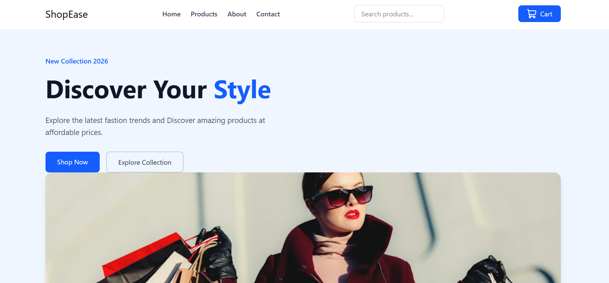
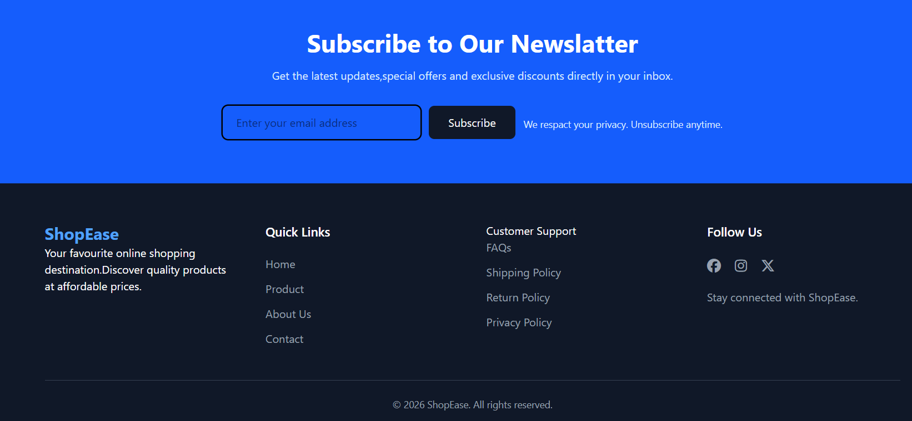

# 🛍️ ShopEase - E-commerce Website

ShopEase is a modern and responsive e-commerce
website built using HTML, CSS and Tailwind CSS.

## 📌 About the Project

ShopEase is a frontend website project created
to practice HTML, CSS and Tailwind CSS.

It provides a clean and user-friendly shopping
interface.

## ✨ Features

- Responsive Navigation Bar
- Shopping Cart UI
- Hero Section
- Featured Products
- Why Choose Us Section
- Newsletter Subscription Section
- Social Media Icons
- Responsive Footer

## 🛠️ Technologies Used

- HTML5
- CSS3
- Tailwind CSS v4
- Vite
- Lucide Icons
- Font Awesome

## 📂 Project Structure

ShopEase-Project/
node_modules
src
.gitignore
about.html
cart.html
contact.html
index.html
package-lock.json
package.json
products-detail.html
products.html
vite.config.js

## 🚀 How to Run Locally

1. Clone this repository:

   git clone https://github.com/Avinash01030/ShopEases-Ecommerce-Website.git

2. Open the project folder:

   cd ShopEases-Ecommerce-Website

3. Install dependencies:

   npm install

4. Start the development server:

   npm run dev

5. Open the local URL shown in your terminal.

## 📸 Screenshots
### Homepage

### Featured Products

### Why Choose Us

### Newsletter and Footer
.

## 👨‍💻 Author

Avinash

GitHub: https://github.com/Avinash01030

## 📄 License

This project is created for learning and
educational purposes.
